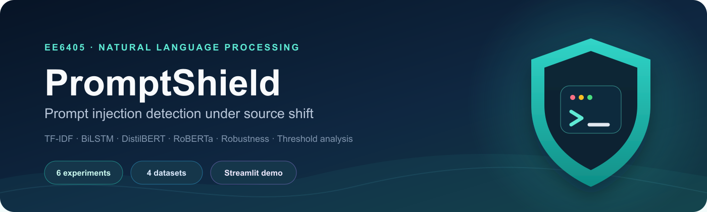
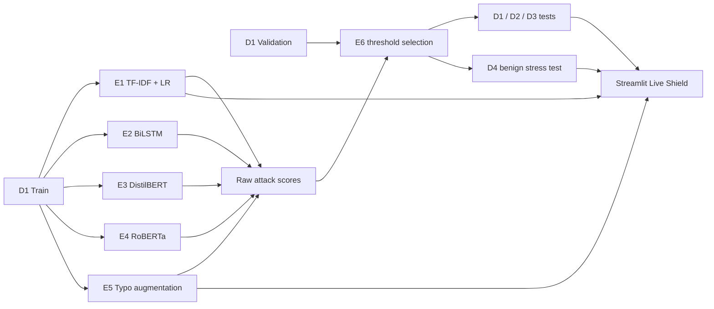
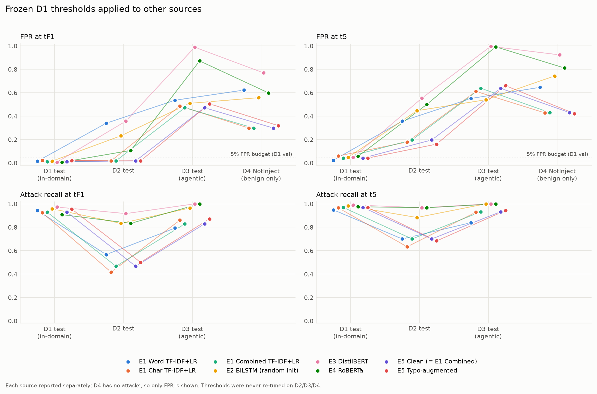
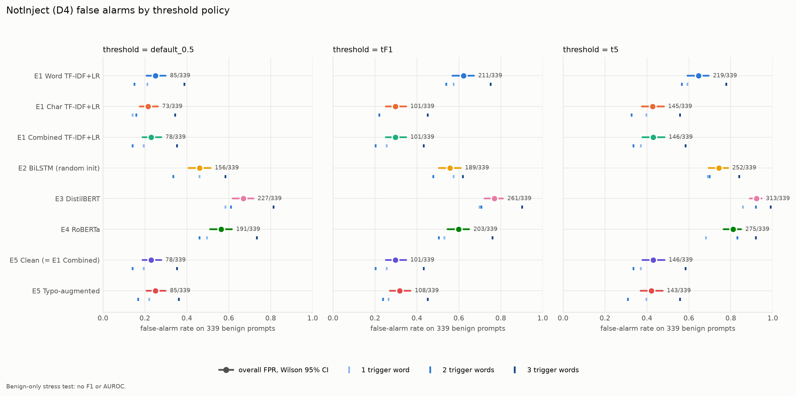

<p align="center">
  
</p>

<p align="center">
  
  
  
  
  
</p>

PromptShield is an EE6405 Natural Language Processing group project that studies prompt-injection detection under controlled source shift. Six experiments compare sparse, recurrent and Transformer detectors, a targeted typo-augmentation intervention, and a unified threshold protocol. A Streamlit interface exposes the frozen E1 and E5 models and summarizes cross-source behavior across all model families.

## Why this project

High in-domain accuracy can hide unsafe behavior after the input source changes. PromptShield therefore separates four evaluation sources, freezes every model before test evaluation, and reports false-positive rate alongside Macro F1 and attack recall.

The main finding is consistent across model families: strong D1 performance does not guarantee a safe operating point on D3 or the benign-only D4 stress test.

## System overview



## Experiments

| Experiment | Question | Main implementation |
|---|---|---|
| **E1** | How strong is an interpretable sparse baseline? | Word, character and combined TF-IDF with Logistic Regression |
| **E2** | Does pretrained embedding initialization help a recurrent model? | BiLSTM with random versus GloVe initialization |
| **E3** | How does a compact pretrained encoder transfer? | DistilBERT learning-rate and seed analysis |
| **E4** | Does a larger encoder improve transfer enough to justify its cost? | RoBERTa accuracy, latency, size and occlusion analysis |
| **E5** | Can controlled typo augmentation improve robustness? | Frozen E1 representation with paired typo intervention |
| **E6** | How do operating thresholds change recall and false alarms? | Validation-only `tF1` and `t5`, confidence intervals and D4 analysis |

## Frozen data protocol

| Dataset | Role | Rows used |
|---|---|---:|
| **D1** — S-Labs Prompt Injection Dataset | Train, validation and internal test | 11,046 / 1,985 / 2,101 |
| **D2** — deepset Prompt Injections | External test only | 116 |
| **D3** — Agentic Prompt Injection 5K | External agentic test only | 545 |
| **D4** — NotInject | Benign-only false-alarm stress test | 339 |

All main detectors train only on D1 Train. Hyperparameters, checkpoints and E6 thresholds are selected only on D1 Validation. D2, D3 and D4 are never used for model selection. Stable `sample_id` values and the audit manifest keep every experiment on the same examples.

## Selected results

Main-pipeline results below use the E6 `tF1` threshold selected on D1 Validation.

| Model | D1 Test Macro F1 | D2 Macro F1 | D3 Macro F1 | D4 benign FPR |
|---|---:|---:|---:|---:|
| E1 Combined TF-IDF + LR | 0.9595 | 0.6992 | 0.6733 | 29.8% |
| E2 BiLSTM | 0.9714 | 0.8010 | 0.7151 | 55.8% |
| E3 DistilBERT | **0.9829** | 0.7785 | 0.3518 | 77.0% |
| E4 RoBERTa | 0.9509 | **0.8621** | 0.4677 | 59.9% |

E5's selected typo augmentation improved attack recall under one random typo by **2.31 percentage points** and clean D1 Macro F1 by **1.34 points**, while D4 FPR at threshold 0.5 increased by **2.06 points**.

<p align="center">
  
  
</p>

## Streamlit demo

The live interface loads the lightweight frozen E1 and E5 pipelines. Research results for E2–E4 are displayed from the final E6 artifacts, so the demo remains usable without loading large Transformer checkpoints.

```bash
git clone https://github.com/Jackie-wjh/promptshield.git
cd promptshield

python3 -m venv .venv
source .venv/bin/activate          # Windows: .venv\Scripts\activate
python -m pip install --upgrade pip
python -m pip install -r requirements.txt
streamlit run app.py
```

The interface provides:

- **Live Shield** — E1/E5 text scoring at frozen E6 operating thresholds
- **Cross-source benchmark** — Macro F1, recall and FPR across D1–D4
- **False-alarm analysis** — D4 counts and confidence intervals
- **Reproducibility** — artifact and checkpoint availability checks

Classifier scores are uncalibrated model outputs. They should not be interpreted as probabilities of maliciousness.

## Reproducing the experiments

Each experiment has its own dependency file because the neural experiments use different library stacks.

```bash
# Data and integrity checks
python scripts/prepare_data.py
python scripts/check_data_integrity.py

# Experiments
python experiments/e1/run_e1.py
python experiments/e2/run_e2.py
python experiments/e3/run_e3.py
python -m experiments.e4.train
python experiments/e5/run_e5.py
python experiments/e6/run_e6.py
```

Before running an experiment, install its pinned environment:

```bash
python -m pip install -r requirements/e3.txt   # replace e3 as needed
```

## Repository layout

```text
promptshield/
├── app.py                   # Streamlit group demo
├── configs/                 # Frozen data and E1–E6 configurations
├── data/
│   ├── audit/               # Manifest, cleaning decisions and integrity report
│   ├── processed/           # Frozen D1–D4 experiment inputs
│   └── raw/                 # Source snapshots used by data preparation
├── experiments/e1 ... e6/   # Training, scoring and analysis code
├── models/                  # Lightweight selected checkpoints tracked by Git
├── requirements/            # Experiment-specific environments
├── results/e1 ... e6/       # Final tables, figures and raw-score handoffs
└── scripts/                 # Data preparation and integrity checks
```

## Checkpoint policy

Git tracks the selected E1, E2 and E5 checkpoints required for the live application and lightweight reproduction. The fine-tuned E3 DistilBERT and E4 RoBERTa weight files are 255 MB and 476 MB, respectively, and exceed GitHub's regular file limit. Their configurations, training code, raw score handoffs, metrics and figures remain in this repository. Recreate them with the E3/E4 experiment commands above.

Tracked checkpoint hashes and the omitted large-weight hashes are recorded in [`MODEL_MANIFEST.json`](MODEL_MANIFEST.json).

## Reproducibility notes

- `data/audit/manifest.json` records dataset revisions, counts and file hashes.
- `data/audit/integrity_report.json` records label mapping, cleaning, overlap and leakage checks.
- `results/*/handoff/` contains one raw attack score per model and sample for E6.
- `results/e6/thresholds.csv` records the selected operating points and tie-breaking rule.
- `results/e6/metrics.csv` and `notinject_false_alarms.csv` are the authoritative comparison tables.

## Data sources and references

Dataset revisions and licenses are recorded in [`configs/data_sources.json`](configs/data_sources.json).

- [S-Labs/prompt-injection-dataset](https://huggingface.co/datasets/S-Labs/prompt-injection-dataset)
- [deepset/prompt-injections](https://huggingface.co/datasets/deepset/prompt-injections)
- [3nesdeniz/agentic-prompt-injection-5k](https://huggingface.co/datasets/3nesdeniz/agentic-prompt-injection-5k)
- [leolee99/NotInject](https://huggingface.co/datasets/leolee99/NotInject)
- [DistilBERT](https://arxiv.org/abs/1910.01108)
- [RoBERTa](https://arxiv.org/abs/1907.11692)

---

Built as the EE6405 Natural Language Processing group project.
